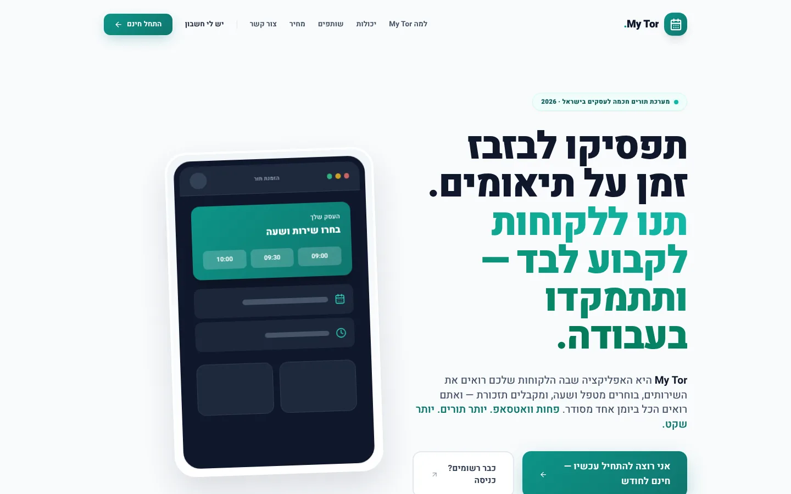
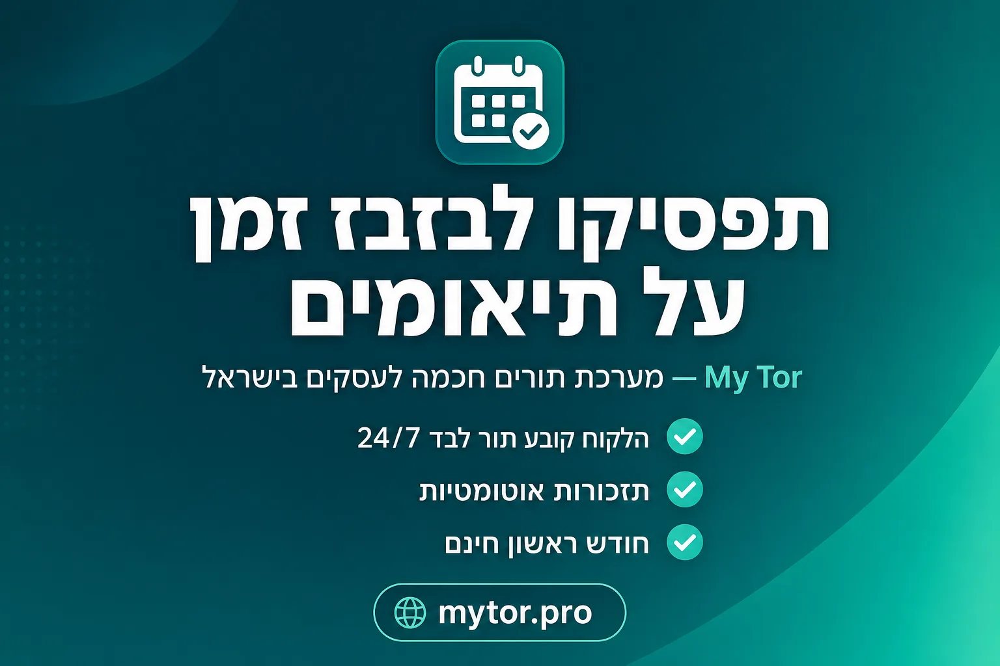
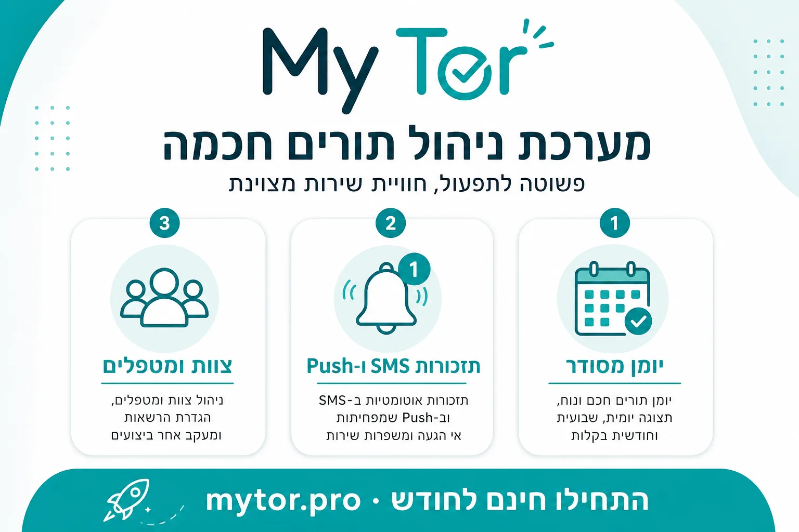
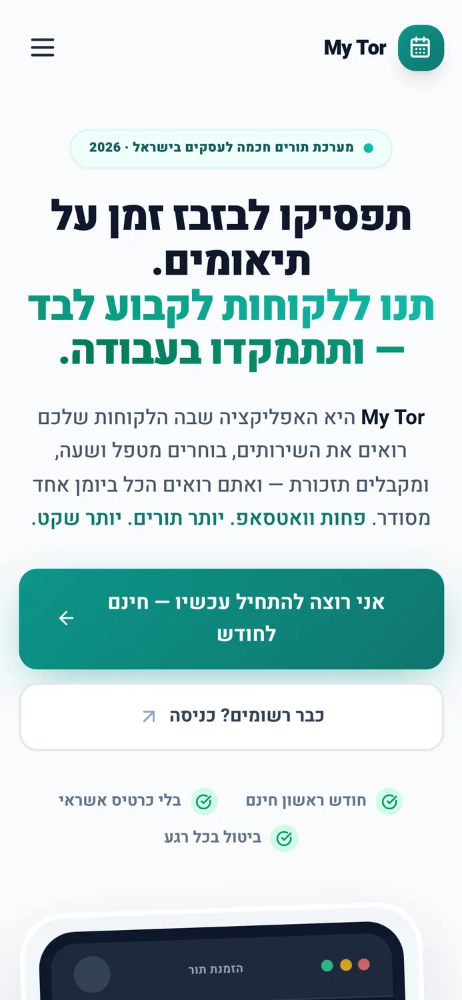

# My Tor

**Clients book on their own, 24/7 — you focus on the work.**

SaaS for service businesses

 

## Overview

Appointment management for businesses that run on bookings — salons, clinics, therapists, coaches and freelancers. Calendar, clients, branded online booking and automatic reminders in one place.

| The challenge | The solution |
| --- | --- |
| Owners lose hours to phone coordination, no-shows and manual reminders, juggling the calendar between spreadsheets and WhatsApp. | I built a full SaaS where every business gets a branded booking page (PWA) for its clients, a smart calendar for staff, and SMS, push and email reminders — with monthly billing and a partner program. |

## Key features

- Branded booking page per business — logo, colors, personal link
- Smart calendar: multiple staff, blocks, holidays, recurring bookings
- Automatic SMS, push and email reminders to cut no-shows
- Client wallet, packages, payments center, chat and referrals

> **Outcome:** Live in production with a one-month free trial — mytor.pro.

## Tech stack

`React 19` `Vite` `Tailwind` `Node.js` `Express` `MySQL` `PWA` `Web Push` `SMS`

## Screenshots

 

  

## My role

Product spec, UX, full-stack development, deployment and ongoing support — built end-to-end by me under **[AZToDev](https://aztodev.com)**.

## About the code

This is a commercial product, so the source code is private. This repository is a public showcase. For a live demo or a technical walkthrough, reach out:

[aztodev.com](https://aztodev.com) · [LinkedIn](https://www.linkedin.com/in/zion-amar) · amzion24@gmail.com

---

### בעברית

**My Tor** — הלקוחות קובעים תור לבד, 24/7 — ואתם מתמקדים בעבודה.

מערכת ניהול תורים לעסקים שחיים מתורים — מספרות, קליניקות, מטפלים, מאמנים ופרילנסרים. יומן, לקוחות, הזמנה אונליין ממותגת ותזכורות אוטומטיות במקום אחד.

